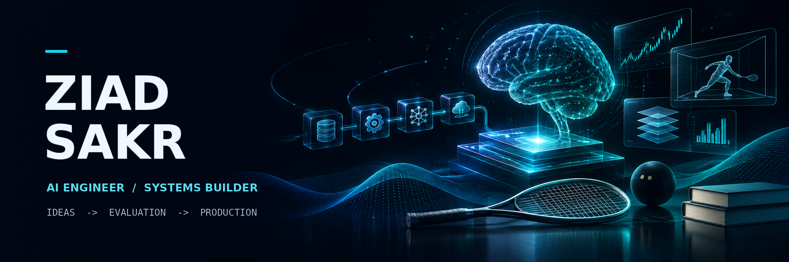
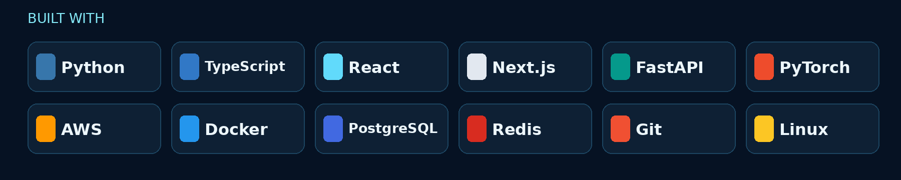

<!--
  Ziad Sakr / GitHub profile
  Profile repository: https://github.com/zsakr/zsakr
  Custom edition: upload the README and the assets directory together.
-->

<b>From ideas to systems that ship.</b>

**Founding AI Engineer** · New York · [ziadsakr.com](https://ziadsakr.com) · [GitHub](https://github.com/zsakr)

---

### The short version

I build **production AI systems**—from autonomous agents and retrieval workflows to computer vision and the infrastructure that makes them reliable. I enjoy the entire process: understanding the problem, designing the system, testing its edge cases, and getting it into people's hands.

Today I work on **AI engineering for healthcare**. My background also includes performance analytics and competitive sport, and I'm exploring the engineering behind **quantitative finance**.

> **The interesting part isn't just making a model work. It's making the whole system work.**

### What I work on

| `01` Agentic systems | `02` Visual intelligence | `03` Production engineering |
| :--- | :--- | :--- |
| LLM workflows, retrieval, tools, orchestration, evaluation, and safety checks. | Computer vision, motion analysis, visual reasoning, and turning raw footage into usable insights. | APIs, async jobs, data pipelines, testing, cloud infrastructure, and dependable deployments. |

### Toolbox

 

`Python` · `TypeScript` · `FastAPI` · `React / Next.js` · `PyTorch` · `PostgreSQL` · `Redis` · `AWS` · `Docker` · `CI/CD`

### On my radar

- **Reliable AI:** strong evaluations, traceability, validation, and agents that behave predictably outside demos.
- **High-performance systems:** fast pipelines, careful architecture, and thoughtful developer experience.
- **Quant engineering:** market-data infrastructure, backtesting, and systematic decision-making.

### Beyond the code

Before engineering, I competed in squash at a high level. It taught me to study tiny details, iterate constantly, and perform under pressure. I bring that same mindset to building software.

---

**Build carefully. Measure what matters. Keep improving.**

Explore my work at <a href="https://ziadsakr.com">ziadsakr.com</a> · Find me on <a href="https://github.com/zsakr">GitHub</a>

